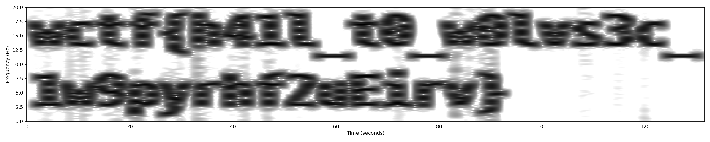

- **Challenge:** Cancelled
- **Category:** Crypto
- **Flag:** `wctf{h41l_t0_w0lvs3c_1w9pyrhf2uEirv}`

---

## My initial read / first impressions

The challenge description says:

```text
band kid intensifies

How does Active Noise Cancellation work? Why do the two files sound the same? How can you hide things in sound? These are the questions you must ask to decrypt the files and find the flag.
```

We get two files, `wav1.wav` and `wav2.wav`. They sound basically the same when played normally, which is exactly what the description is pointing at.

The active noise cancellation hint made me think about subtracting the two signals. If both files have the same music in them, subtracting one from the other should cancel that part out and leave whatever is different.

## Comparing the audio

I checked the WAV files first:

```bash
file wav1.wav wav2.wav
```

Both are 16-bit mono PCM at 44100 Hz, and they're the same length (about 131 seconds). That means we can subtract the samples directly without having to sync or resample either file first.

The important thing is to convert the samples to a larger type before subtracting. They're stored as 16-bit integers, so doing the subtraction in that type could overflow.

After subtracting them, most of the interesting signal is below 20 Hz. That's why listening to the two files doesn't really tell us anything useful. The difference is down in the frequencies we can't normally hear.

## Looking at the difference

I downsampled the difference and plotted a spectrogram of the 0-20 Hz range. The downsampling keeps the plot manageable, and the spectrogram lets us see how the frequencies change over time.

This is what came out:



There are two lines of text. The upper line is around 12-19 Hz, and the lower one is around 2-9 Hz. Reading the top line first and then the bottom gives the flag. Some of the characters are pretty easy to mix up at this resolution, especially the numbers.

## Solution script

```python
#!/usr/bin/env python3
import matplotlib.pyplot as plt
import numpy as np
from scipy.io import wavfile
from scipy.signal import resample_poly, stft


rate, a = wavfile.read("wav1.wav")
rate2, b = wavfile.read("wav2.wav")
assert rate == rate2 and a.shape == b.shape

# Subtract the shared audio without overflowing int16.
diff = (a.astype(np.float64) - b.astype(np.float64)) / 32768

# Everything we care about is below 20 Hz.
low = resample_poly(diff, 1, 100)
freq, times, spec = stft(low, fs=rate / 100, nperseg=2048, noverlap=2008)
db = 20 * np.log10(np.maximum(np.abs(spec), 1e-9))
show = (freq >= 0) & (freq <= 20)

fig, ax = plt.subplots(figsize=(20, 4))
ax.pcolormesh(times, freq[show], db[show], shading="auto",
              cmap="gray_r", vmin=-65, vmax=-23)
ax.set_ylim(0, 20)
ax.set_xlabel("Time (seconds)")
ax.set_ylabel("Frequency (Hz)")
fig.tight_layout()
fig.savefig("cancelled-spectrogram.png", dpi=160)
```

Running it with both WAV files in the same directory:

```bash
python3 solve.py
```

The output is `cancelled-spectrogram.png`. There's no audio to decrypt after that; the flag is written directly into the frequency plot.

## Why this works

The two WAVs share the same audible audio, so subtracting their samples removes most of it. What's left contains the hidden message, encoded as shapes at very low frequencies.

It's the same idea as the cancellation hint in the description, except we're doing it on the recorded samples and then looking at the result instead of trying to listen to it.

## Final flag

```text
wctf{h41l_t0_w0lvs3c_1w9pyrhf2uEirv}
```
