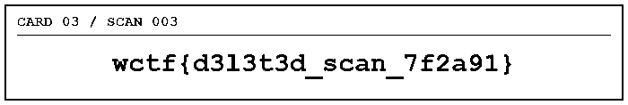

- **Challenge:** The Missing Scan
- **Category:** Forensics
- **Flag:** `wctf{d3l3t3d_scan_7f2a91}`

---

## My initial read / first impressions

The challenge description says:

```text
The camera card was cleared after its last scan, but the card itself survived. What did the missing scan show?
```

We get a `dis (1).tar.gz` archive with one file inside, `card.img`:

```bash
tar -tzf "dis (1).tar.gz"
tar -xzf "dis (1).tar.gz"
file card.img
```

`file` identifies it as a FAT12 filesystem. Since the description says the card was cleared, I figured the scan was probably deleted rather than hidden inside another file.

## Finding the deleted file

FAT keeps file entries in its directory table. Deleting a file changes the first byte of its directory entry to `0xe5`, but the entry can still have the filename, starting cluster, and file size.

The boot sector gives us the layout of this image:

```text
Bytes per sector:     512
Sectors per cluster:  4
Reserved sectors:     1
Number of FATs:       2
Sectors per FAT:      9
Root entries:         224
```

The root directory starts after the reserved sector and both FATs:

```text
(1 + 2 * 9) * 512 = 9728
```

Looking at the first directory entry:

```bash
od -Ax -tx1 -N 32 -j 9728 card.img
```

```text
002600 e5 43 41 4e 30 30 30 33 50 4e 47 20 00 00 00 00
002610 00 00 00 00 00 00 00 00 00 00 02 00 fc 03 00 00
```

The first byte is `e5`, so it's a deleted entry. The rest of the name is `CAN0003.PNG`, which was most likely `SCAN0003.PNG` before the first character got overwritten.

The last few bytes also tell us where the file was stored:

```text
Starting cluster: 2
File size:        0x3fc = 1020 bytes
```

## Recovering the scan

There are 224 root directory entries, each 32 bytes, so the directory takes up 14 sectors. That puts the start of the data region at:

```text
(1 + 2 * 9 + 14) * 512 = 16896
```

FAT cluster numbering starts at 2, meaning cluster 2 is right at the start of the data region. Each cluster holds `4 * 512 = 2048` bytes, and our PNG is only 1020 bytes. So the whole file fits in one cluster, and we don't need to recover a FAT chain.

I carved those 1020 bytes directly:

```bash
dd if=card.img of=recovered_scan.png bs=1 skip=16896 count=1020
file recovered_scan.png
```

That gives a valid 700x118 PNG. Opening it shows the flag printed in the middle of the scan:



## Why this works

Deleting a file from FAT doesn't immediately wipe its contents. The directory entry gets marked as deleted, and its clusters are available for reuse, but the data stays there until something overwrites it.

In this case, the PNG was small enough to fit in a single cluster, and that cluster hadn't been overwritten. The directory entry still gave us both the starting cluster and the exact file length, so recovering it was just a matter of copying the right bytes out of the image.

## Final flag

```text
wctf{d3l3t3d_scan_7f2a91}
```
